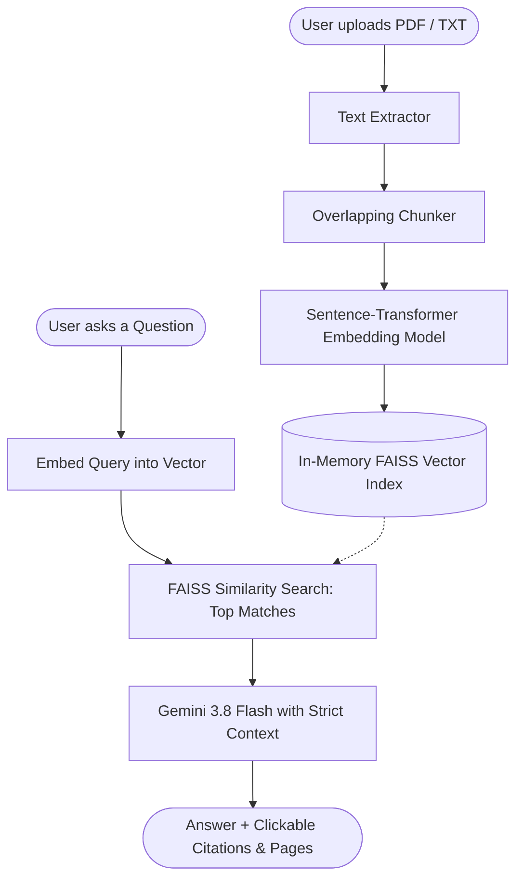

# 🏆 Project Presentation & Architecture Guide (For Hackathon Judges)

> **Project Name:** Sylva / DocMind — Grounded Document Intelligence Assistant  
> **Core Technology:** Retrieval-Augmented Generation (RAG) with Django, FAISS, Sentence-Transformers, and Google Gemini.

---

## 1. Executive Summary (The 30-Second Elevator Pitch)

Most AI chatbots suffer from a critical flaw: **hallucination**. They make up facts with high confidence. For legal, medical, academic, or corporate documents, that is unacceptable.

**Our Solution:** A high-speed, verifiable **Document Intelligence Assistant**. 
- You upload any PDF or TXT document (e.g., medical certificates, contracts, financial reports).
- You ask questions in natural language.
- The system retrieves the exact relevant passages and generates answers **grounded strictly in your file**.
- Every single claim is backed by **verifiable citations** (page number and exact text passage).
- **Zero Guesswork Guarantee:** If the answer is not in the document, it explicitly tells you: *"Information could not be found in the uploaded document."*

---

## 2. Demystifying the Buzzwords (Plain English Explanations)

| Term | In Plain English | Why It Matters Here |
| :--- | :--- | :--- |
| **RAG (Retrieval-Augmented Generation)** | An **"open-book exam"** for AI. Instead of answering from memory, the AI looks up the exact paragraphs in your file first, then writes an answer citing them. | Eliminates hallucinations and provides verifiable proof. |
| **Embeddings** | Turning text into a **mathematical fingerprint** based on its meaning, not just exact keywords. ("Physician" and "Doctor" have almost identical math vectors). | Enables conceptual search even if the user doesn't use the exact words from the file. |
| **Vector Store (FAISS)** | A lightning-fast search engine built by Meta for numbers/vectors. | Searches through thousands of text chunks in milliseconds to find the closest match. |
| **Chunking** | Chopping a 50-page document into bite-sized paragraphs with overlap. | Language models can't ingest endless text without losing focus; chunks isolate precise answers. |

---

## 3. High-Level System Architecture

---

## 4. Codebase Walkthrough (Module by Module)

The codebase is split into two clean, decoupled halves: the **AI/RAG Engine** (`rag_engine/`) and the **Web Application Backend & UI** (`doc_assistant/` + `templates/`).

### 🧩 Part A: The AI & RAG Engine (`rag_engine/`)

#### 1. `extractor.py` (Document Ingestion)
- **What it does:** Reads incoming `.pdf` files using `pypdf` or `.txt` files.
- **Judge Highlights:**
  - Robust multi-encoding support (`utf-8`, `utf-8-sig`, `latin-1`, `cp1252`) so it never crashes on Windows or strange text formats.
  - Safe fallbacks: handles scanned/image PDFs gracefully without breaking the pipeline.

#### 2. `chunker.py` (Smart Segmentation)
- **What it does:** Takes document pages and divides them into 500-character chunks with a 100-character overlap.
- **Why overlap matters:** If an important name or sentence falls on a boundary, the 100-character overlap ensures context is never cut in half.
- Assigns unique, trackable chunk IDs for granular citations.

#### 3. `vectorstore.py` (The Mathematical Search Engine)
- **What it does:** 
  - Embeds chunks locally using `all-MiniLM-L6-v2` (384-dimensional vector space).
  - Stores vectors in a `faiss.IndexFlatL2` index.
- **Judge Highlights:**
  - **Local speed & privacy:** Embeddings run in-memory on the server—no slow third-party API calls needed just to index words.
  - Returns the top $K$ most relevant chunks ranked by mathematical similarity.

#### 4. `generator.py` (Strict Grounded Answer Synthesis)
- **What it does:** Sends the user's question + retrieved context chunks to Google's **Gemini 3.8 Flash**.
- **Judge Highlights:**
  - Strict system instructions: *"Answer strictly using provided context. If missing, output EXACTLY: 'Information could not be found in the uploaded document.'"*
  - Dual-model fallback: targets `gemini-3.8-flash` with automatic fallback to `gemini-flash-latest`.
  - Parses cited chunks to display as clickable evidence badges.

---

### 🌐 Part B: Web Framework & User Experience (`doc_assistant/` & Frontends)

#### 1. `views.py` (API Controllers)
- **`upload_document`:** 
  - Handles multipart uploads for both `file` and `document` keys.
  - Persists file to disk, runs extraction, chunking, and FAISS indexing, and registers document metadata.
- **`ask_question`:**
  - Validates question input, performs similarity search in FAISS, and passes top context to Gemini.
  - Formats responses with `sources` (including document name, page number, passage text, and relevance score).
- **`delete_document`:** Enables live removal from the document library.

#### 2. `urls.py` (Routing)
- Unified routing that seamlessly bridges the modern landing page (`/`), multi-document workspace (`/workspace/`), and single-document explorer (`/app/`).

#### 3. UI Experiences
- **Landing Page (`templates/landing.html`):** A dark-mode, glassmorphic presentation explaining the value proposition.
- **Workspace UI (`templates/workspace.html` & `static/js/workspace.js`):** 
  - Interactive multi-document library with checkbox filters.
  - Dynamic chat thread with keyword highlighting, passage previews, and quick suggestion chips.
  - Collapsible source evidence drawer showing exact matching passages.

---

## 5. Key Competitive Advantages to Highlight to Judges

1. **Grounded & Trustworthy:** Unlike general LLMs, it eliminates hallucinations by strictly isolating the context window to uploaded files.
2. **True Traceability:** Users don't have to take the AI's word for it; they can click a citation and see the exact snippet and page it came from.
3. **Hybrid Architecture (Local Embeddings + Cloud Reasoning):**
   - Text parsing and vector similarity are computed locally using FAISS for low latency.
   - Only the refined, relevant context is sent to Gemini, reducing token costs and maximizing speed.
4. **Resilient Production Design:**
   - Multi-encoding text decoding.
   - Dual-model API fallback.
   - Clean separation of concerns between AI core and web presentation layer.

---

## 6. Live Demo Flow for Judges (Recommended Script)

1. **Step 1: Upload a Real Document**
   - Drag and drop a document (e.g., a medical certificate or report) into the workspace.
   - Point out the instant chunking and indexing status.
2. **Step 2: Ask a Direct Question**
   - *Example:* *"What symptoms was the patient diagnosed with?"*
   - Show the instant answer, highlighted keywords, and the source citation card showing the exact paragraph.
3. **Step 3: Test the Hallucination Guardrail (Crucial for Judges!)**
   - *Example:* *"What is the stock price of Apple mentioned in this file?"*
   - Show that the assistant does **not** hallucinate or invent an answer—it states that the information cannot be found in the uploaded document.
